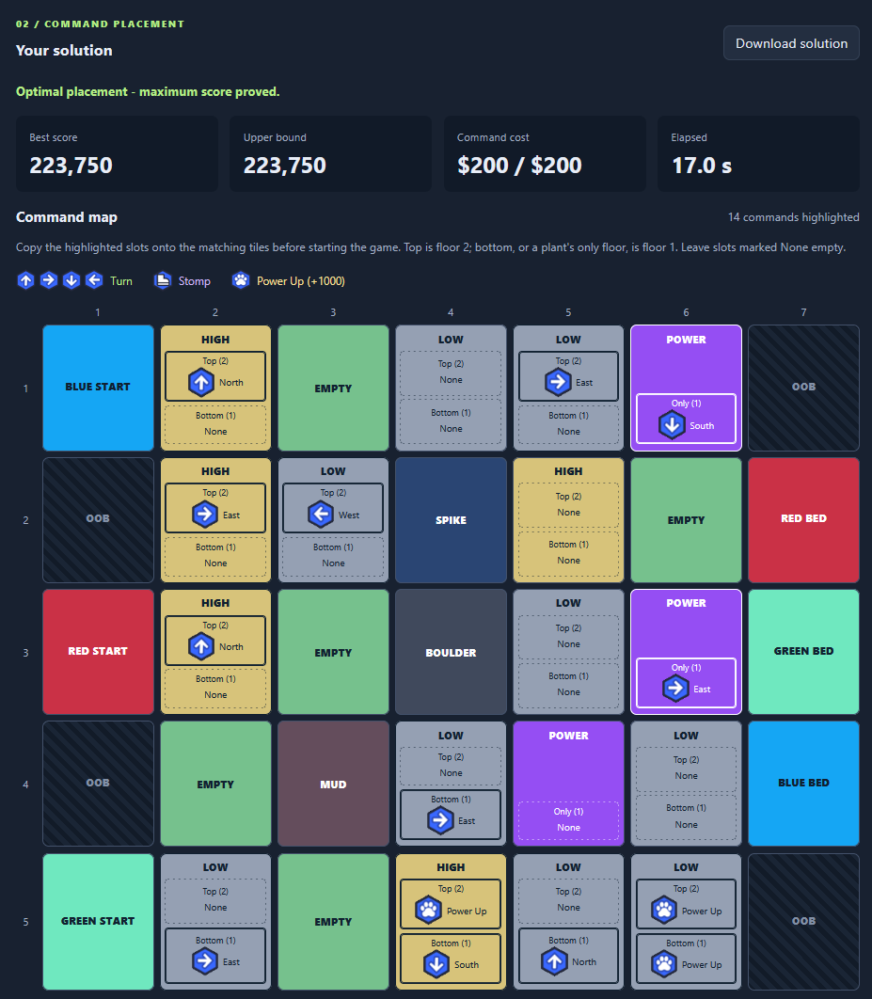

# Kaiju Cat Planner

A local map editor and command-placement optimizer for **Kaiju Cats**. Recreate
your map, find a placement that maximizes the cats' combined power over 15 turns
with a $200 command budget, and copy the commands back into the game.

**[Play the full game on Roblox](https://www.roblox.com/games/13977123257/Kaiju-Cats)**

## Example

The solution is displayed directly on the map, with separate top- and
bottom-floor command slots.



## Run locally

Requires **Python 3.10 or newer** and a web browser. All solving runs locally.

For first-time setup, run these commands in **PowerShell** from the project
directory:

```powershell
python -m venv .venv
.\.venv\Scripts\python.exe -m pip install -r requirements.txt
```

Start the app:

```powershell
.\.venv\Scripts\python.exe app.py
```

Open **http://127.0.0.1:8765**. To use another port, add `--port 8766`.
Press **Ctrl+C** in the server terminal to stop it.

## Use the planner

1. Select a tile type and paint the grid to match your game. Building, obstacle,
   and power-plant counts can vary; cats, beds, and out-of-bounds cells stay fixed.
2. Click **Find optimal placement**. By default, the search continues until
   optimality is proved. You can instead choose a time limit or stop early.
3. Copy the highlighted commands onto the corresponding tiles. **Top is floor
   2**, **bottom is floor 1**, and power plants have only floor 1. Leave slots
   marked **None** empty.
4. Inspect the turn-by-turn replay, save or load maps as JSON, and use
   **Download solution** to keep the commands, scores, map, and complete trace.

The current map is saved in browser storage. Search results are held in server
memory, so download any results you want to keep before restarting the app.

## Optimality and runtime

The optimizer uses **Google OR-Tools CP-SAT** with optimistic route bounds to
prune the search. An **optimal** result means the maximum score has been proved
under the implemented rules.

A stopped or time-limited search returns the **best placement found**, which is
not necessarily optimal. The interface displays both its score and an upper
bound. Runtime varies with the map; difficult layouts can take much longer.
Real-game spike rounding is still unconfirmed; the planner currently uses
exact halves.

## Command-line usage

Use a map exported by the editor, adjusting the file paths as needed:

```powershell
.\.venv\Scripts\python.exe optimize.py --map .\kaiju-map.json --seconds 0 --output .\kaiju-solution.json
.\.venv\Scripts\python.exe simulator.py .\kaiju-solution.json --trace
```

Map input can be a 5-by-7 JSON grid or a JSON object containing a `map` field.
The CLI defaults to a 120-second search limit; `--seconds 0` removes that limit.
Output status `OPTIMAL` indicates a proven maximum, while `FEASIBLE` indicates a
valid placement without an optimality proof.

## Game rules

See [GAME_RULES.md](GAME_RULES.md) for the canonical maintainer reference:
board constraints, turn order, shared floors, commands, fights, rebounds, bed
bonuses, the reference map, and the explicitly documented rounding assumption.

Command artwork lives in `icons\`, and the tile palette is defined in
`web\style.css`.

The local Python environment, bytecode caches, and default generated solution
files are excluded by `.gitignore`. Keep application source, regression tests,
icons, and `example.png` with the project.
